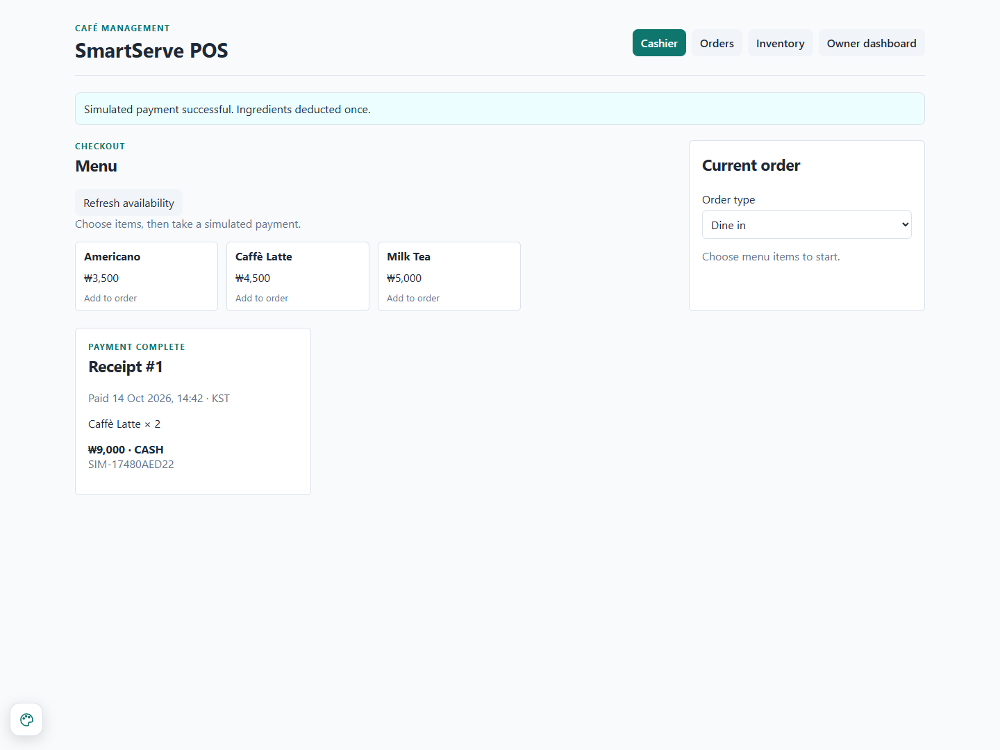
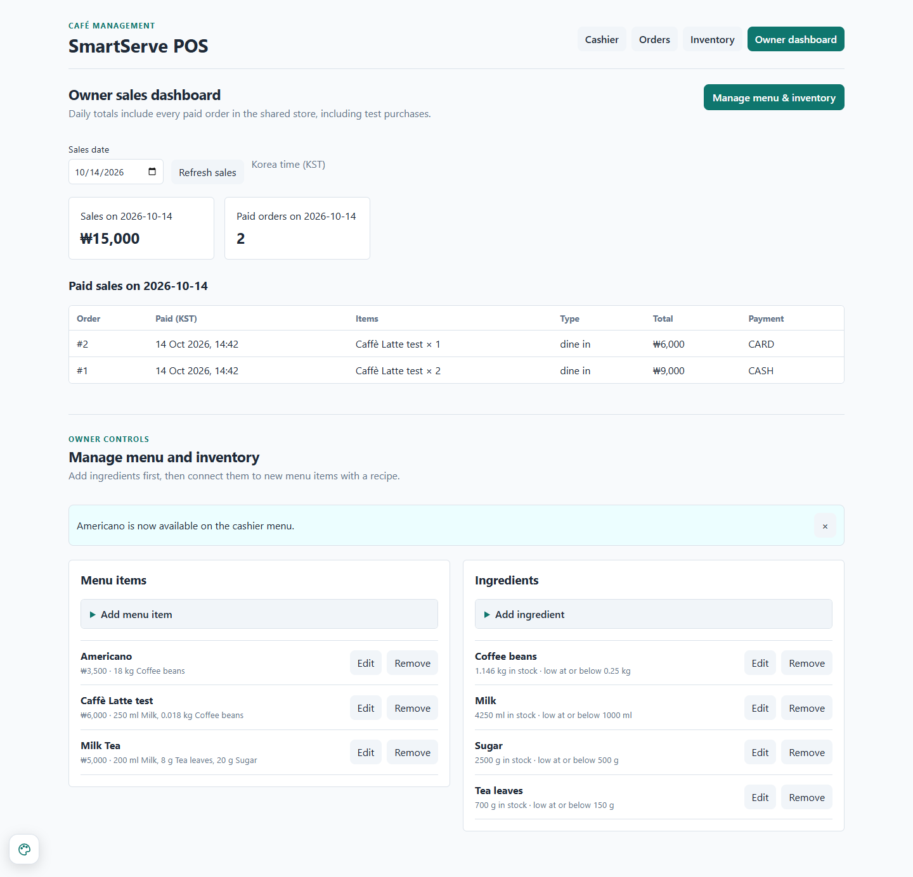

# October 14 evidence

Source: checkout f4e8a6d; application source df2f357. All records use separate sample data. These screenshots were captured by automation on October 14, not by an independent teammate. No stock, order, or sales data from the shared store were used.

## Result files

- [Raw expected/actual results](results.json): 12 pass, 3 fail.
- [PostgreSQL record counts and movement quantities](database-check.json).
- [Existing backend tests](backend-tests.txt): 20 pass.
- [Frontend build](frontend-build.txt): pass.
- [Source and file checksums](manifest.json).
- [Initial run](initial-run/results.json): recovery was checked before loading finished; all original screenshots retained under initial-run/screenshots.

## Screenshot sequence

| Screenshot | What it shows |
|---|---|
| [01-inventory-before.png](screenshots/01-inventory-before.png) | Fresh sample inventory before orders. |
| [02-unpaid-two-latte-order.png](screenshots/02-unpaid-two-latte-order.png) | Two lattes saved as open for ₩9,000; no stock deducted. |
| [03-recovered-unpaid-order.png](screenshots/03-recovered-unpaid-order.png) | Same unpaid order recovered after refresh and data loading. |
| [04-paid-original-receipt.png](screenshots/04-paid-original-receipt.png) | Original cash receipt: Caffè Latte × 2, ₩9,000. |
| [05-inventory-after-first-payment.png](screenshots/05-inventory-after-first-payment.png) | Milk 4,500 ml and beans 1,164 g after first payment/duplicate attempt. |
| [06-saved-ingredient-in-kilograms.png](screenshots/06-saved-ingredient-in-kilograms.png) | Coffee beans converted to kg with recipe quantities converted. |
| [07-menu-renamed-and-repriced.png](screenshots/07-menu-renamed-and-repriced.png) | Menu renamed to Caffè Latte test and repriced at ₩6,000. |
| [08-historical-receipt-after-menu-edit.png](screenshots/08-historical-receipt-after-menu-edit.png) | Failure: original receipt has the new name; original total remains ₩9,000. |
| [09-new-price-card-receipt.png](screenshots/09-new-price-card-receipt.png) | New card receipt uses ₩6,000 price. |
| [10-inventory-after-second-payment.png](screenshots/10-inventory-after-second-payment.png) | Beans 1.146 kg and milk 4,250 ml after the new sale. |
| [11-daily-sales.png](screenshots/11-daily-sales.png) | Two paid orders, ₩15,000 on the selected KST date. |
| [12-recipe-edit-18-grams.png](screenshots/12-recipe-edit-18-grams.png) | Recipe edit input explicitly selects g and enters 18. |
| [13-recipe-saved-wrong-unit.png](screenshots/13-recipe-saved-wrong-unit.png) | Failure: saved Americano recipe displays 18 kg. |
| [14-incorrect-americano-shortage.png](screenshots/14-incorrect-americano-shortage.png) | Failure consequence: Americano needs 18 kg and is unavailable. |

## Key passing result

## Failure to fix

See the [automated check](../../automated-check.md) and [shared report](../../weekly-report.md).
