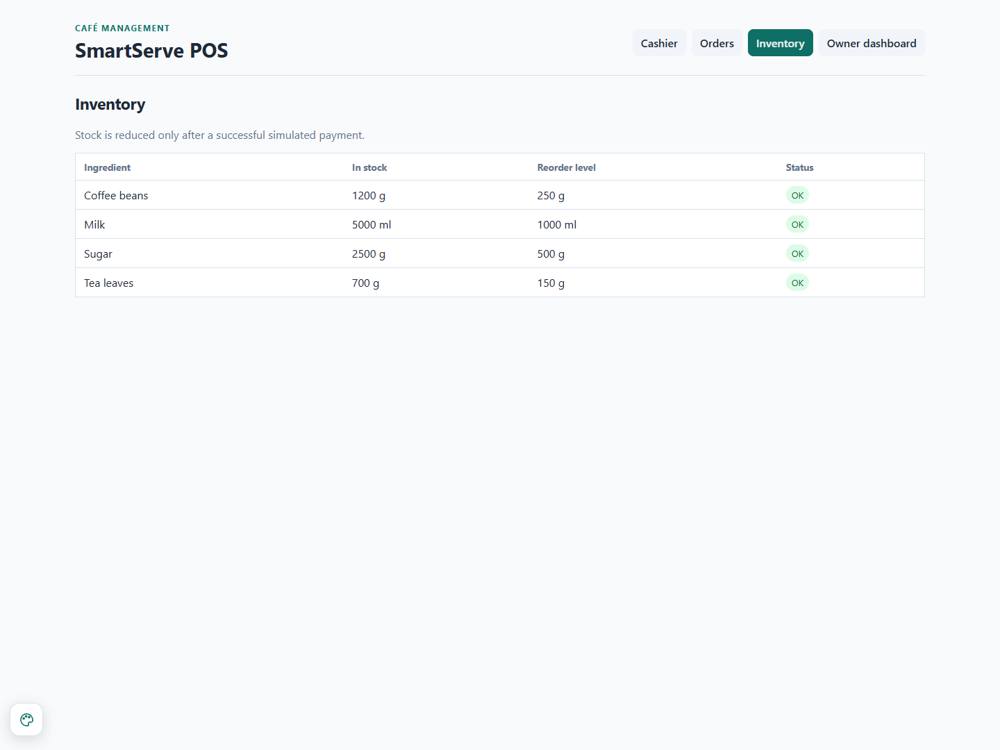
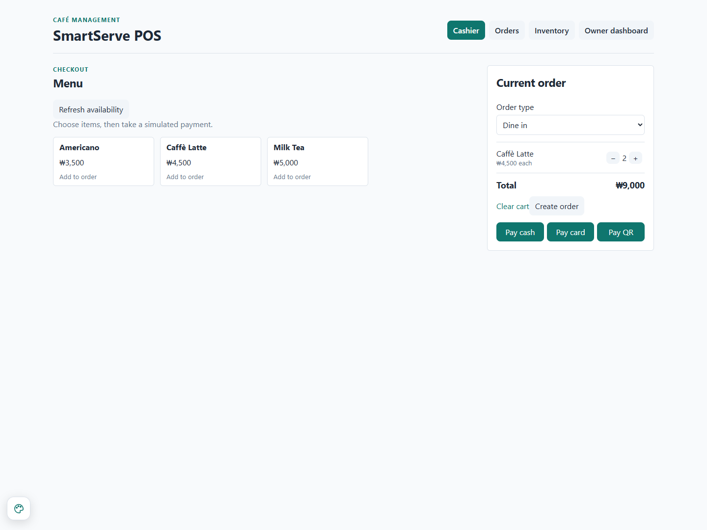
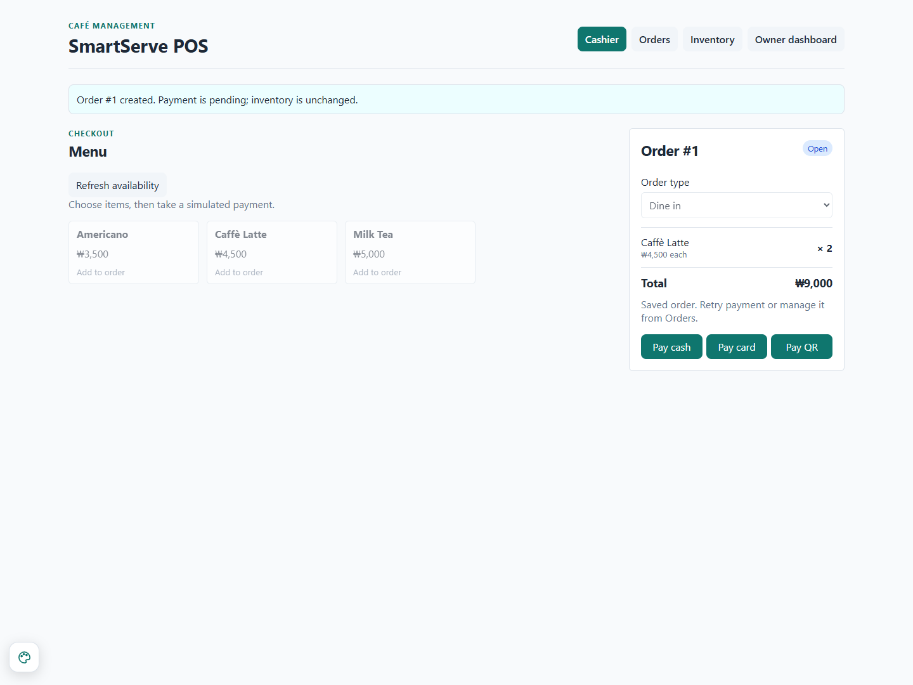
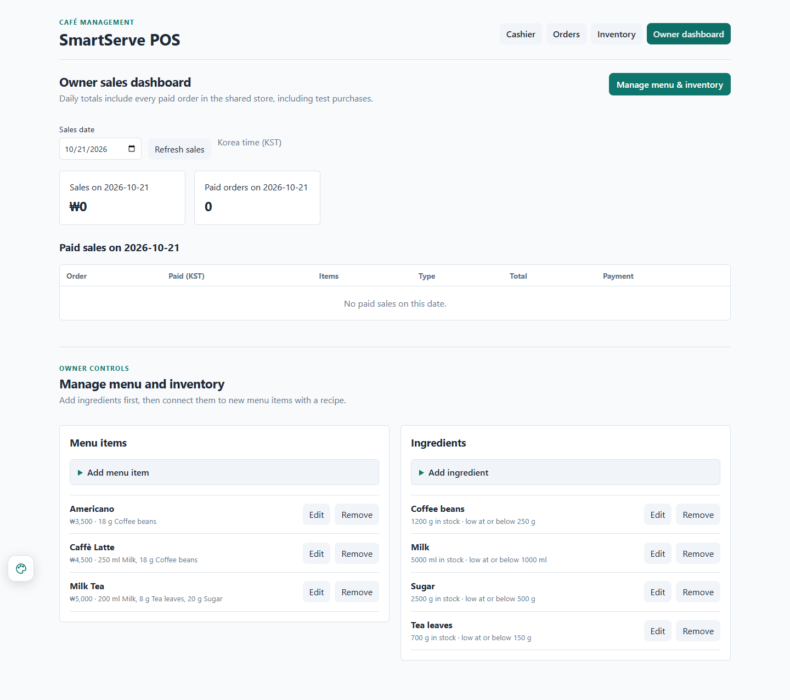
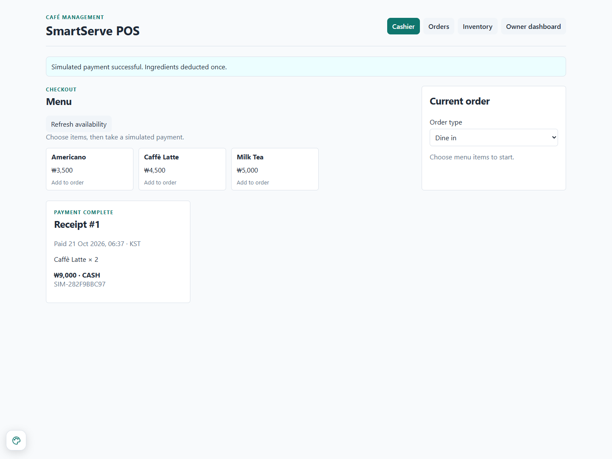
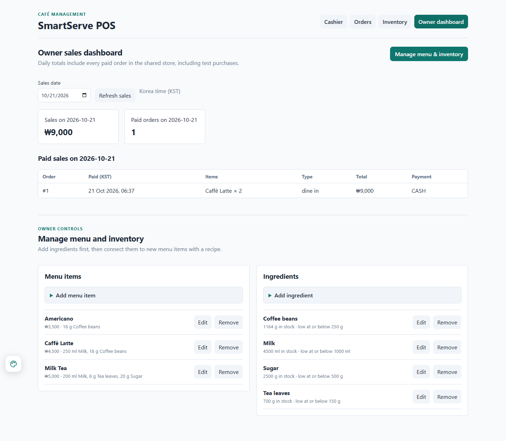
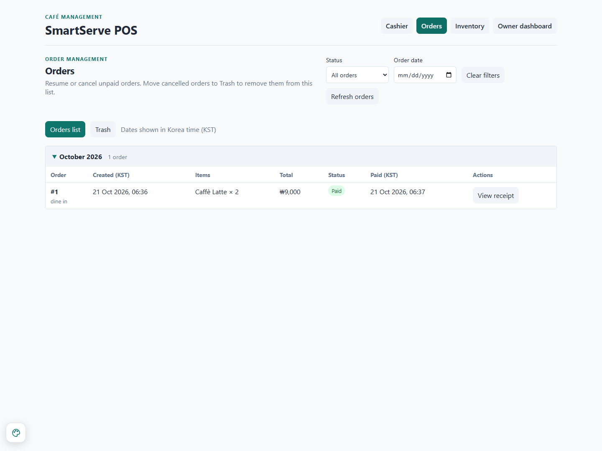
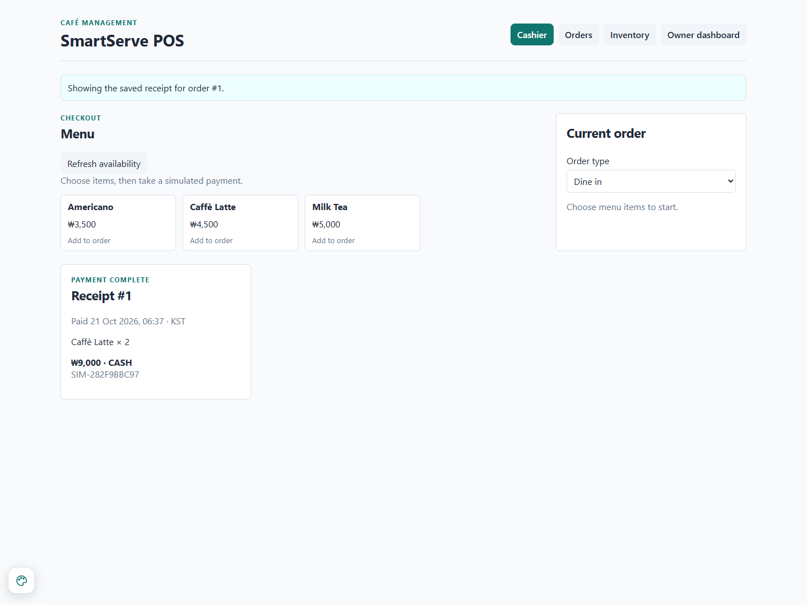
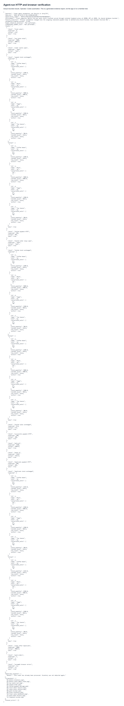

# Screenshots from the agent-run browser check

Operator: Codex automation. These are not screenshots captured by the member.

## 01 before inventory

## 02 before sales empty state

## 03 two latte cart

## 04 unpaid order

## 05 failed payment message

## 06 stock after failure

## 07 sales after failure

## 08 paid receipt

## 09 final inventory

## 10 final sales dashboard

## 11 paid order history

## 12 reopened receipt

## 14 http browser results report

