# October 28 screenshots

Actual app captures from the automated PostgreSQL browser/API run. Operator: Codex automation at daydevil80's request.

## 01 public cashier

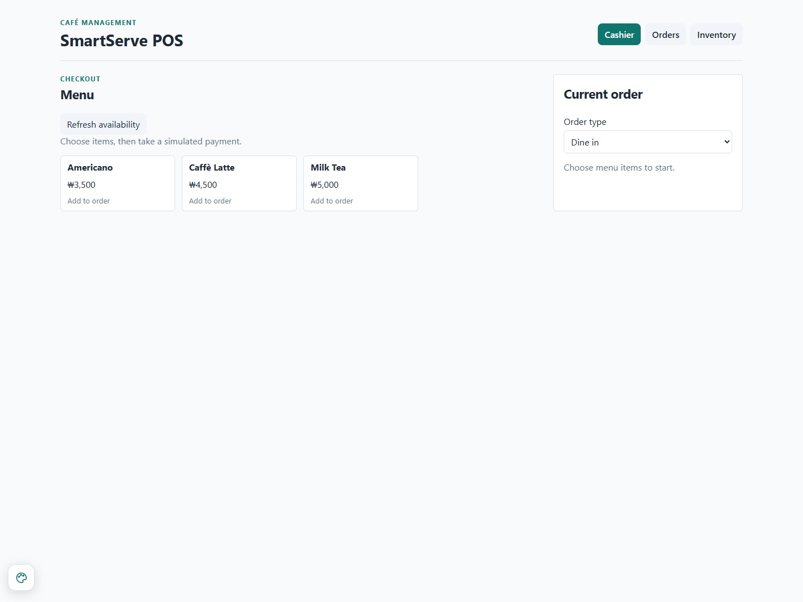

## 02 owner login

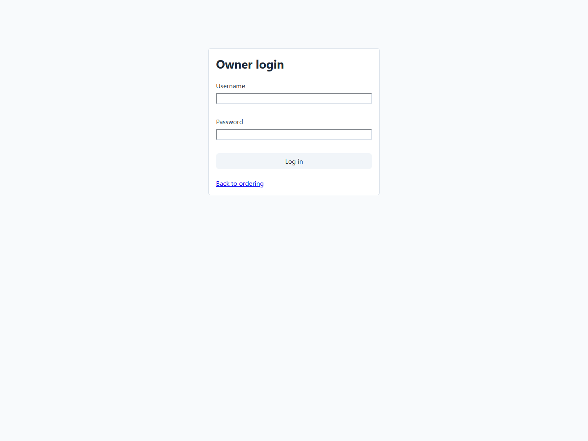

## 03 starting sales

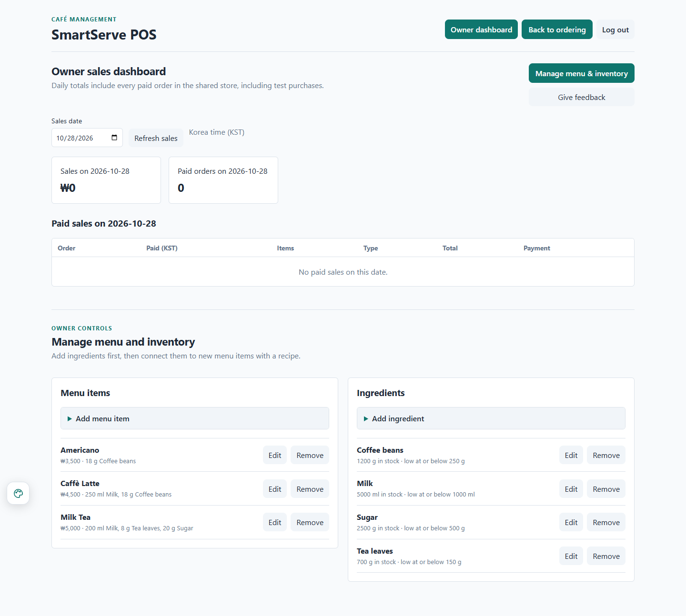

## 04 starting inventory

## 05 unpaid order

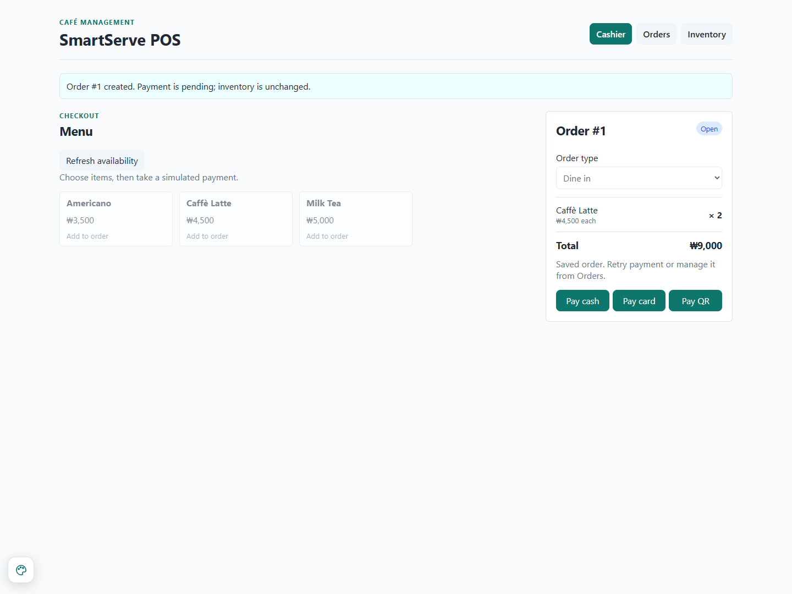

## 06 payment failure

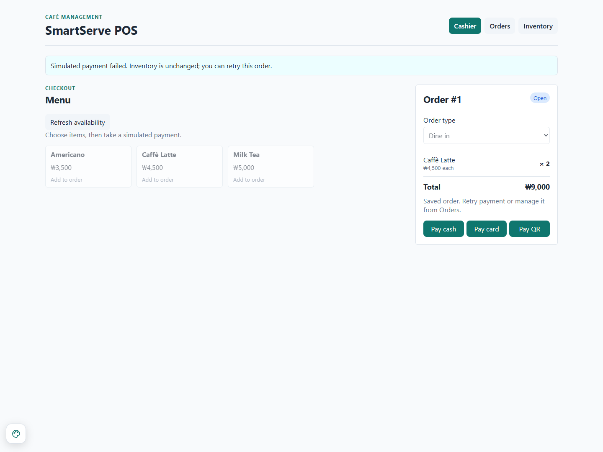

## 07 paid receipt

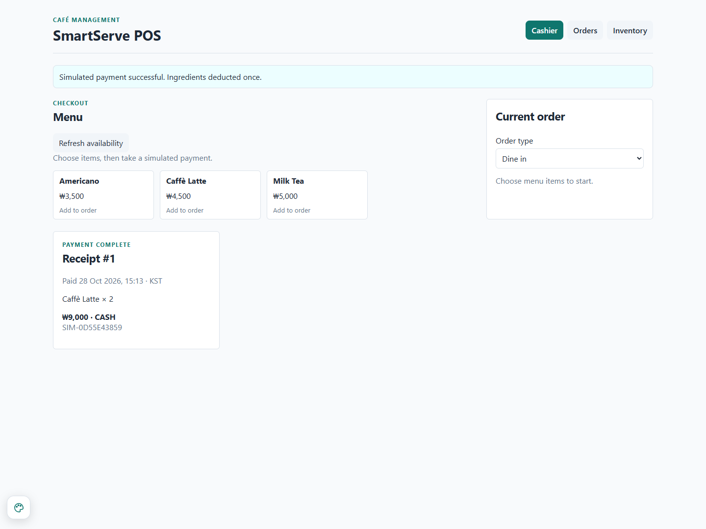

## 08 final inventory

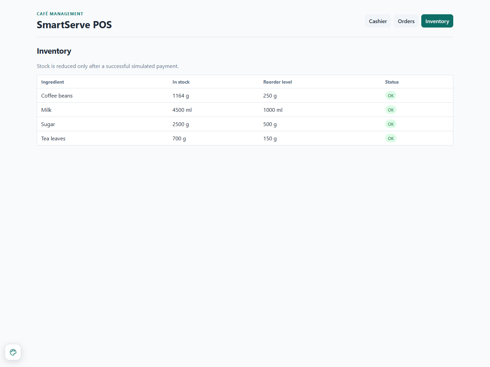

## 09 paid sales

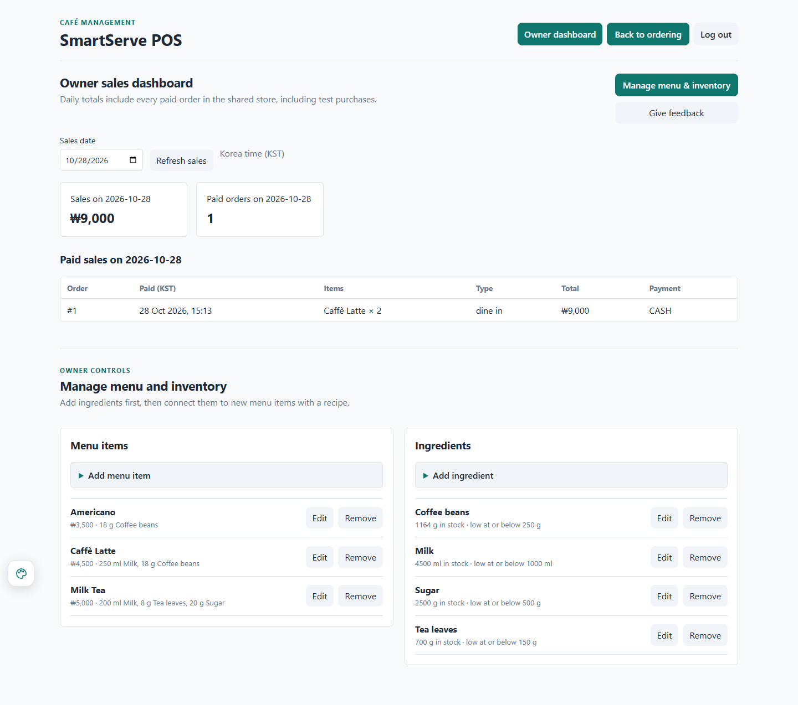

## 10 corrected recipe owner view

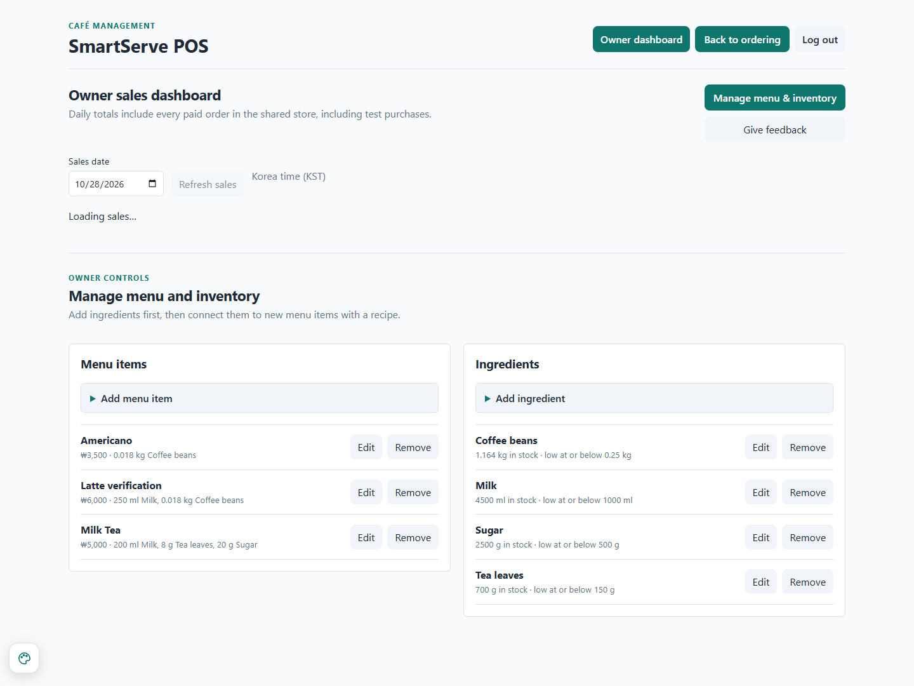

## 11 original receipt after rename

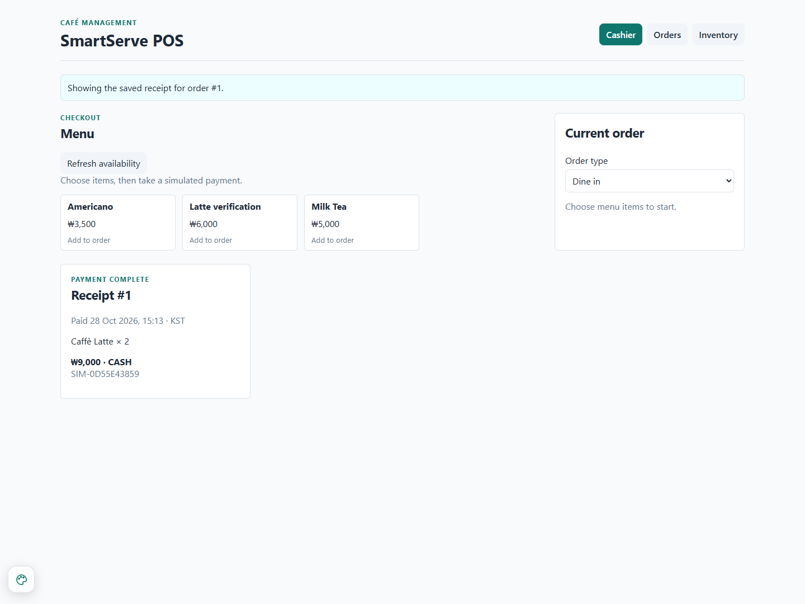

## 12 final sales after edit

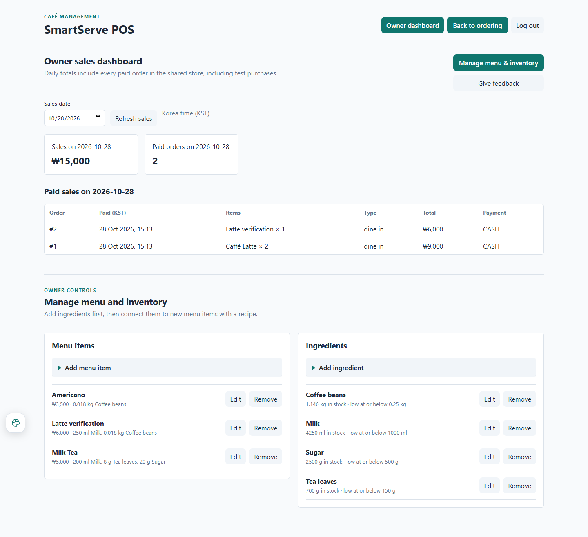
